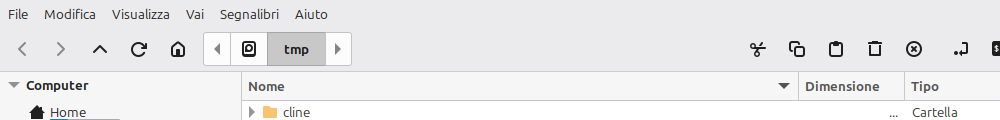
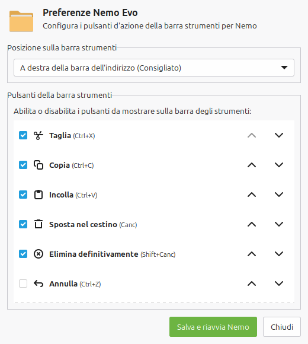

# Nemo Evo 🚀

Customizable action buttons toolbar extension for the **Nemo File Manager** on **Linux Mint (Cinnamon)**.



---

## 🌟 Overview

By default, the Nemo file manager in Linux Mint / Cinnamon does not offer toolbar buttons for common file operations such as **Cut**, **Copy**, **Paste**, **Move to Trash**, and **Delete**. Users are typically forced to rely on keyboard shortcuts or right-click context menus.

**Nemo Evo** solves this problem by seamlessly injecting customizable, native GTK action buttons directly onto Nemo's primary toolbar (right next to the address/path bar).

### ✨ Features

- ✂️ **Cut** (`Ctrl+X`)
- 📋 **Copy** (`Ctrl+C`)
- 📄 **Paste** (`Ctrl+V`)
- 🗑️ **Move to Trash** (`Delete`)
- ❌ **Permanently Delete** (`Shift+Delete`)
- ↩️ **Undo** (`Ctrl+Z` - optional)
- ↪️ **Redo** (`Ctrl+Y` - optional)
- ☑️ **Select All** (`Ctrl+A` - optional)
- 📁 **New Folder** (`Ctrl+Shift+N` - optional)
- ⚙️ **GUI Preferences Editor**: Easily enable/disable buttons, reorder them, and choose their toolbar position.
- 🎨 **Native Theme Integration**: Uses standard Cinnamon symbolic icons and flat GTK button styling.
- 🌍 **Internationalization (i18n)**: Out of the box support for English (`en`) and Italian (`it`).

---

## 🖼️ Preferences & Customization

Nemo Evo includes a standalone GTK3 configuration tool to customize your toolbar layout:



- **Toggle Buttons**: Choose which buttons appear on your toolbar.
- **Reorder Buttons**: Move buttons up or down (▲ / ▼) to match your workflow.
- **Position Options**:
  - *Right of Address Bar* (Default & Recommended)
  - *Left of Address Bar*
  - *Far Right of Toolbar*
- **One-Click Apply**: Save settings and restart Nemo instantly.

You can launch the preferences manager anytime from your application menu under **Preferences -> Nemo Evo Preferences**, or via terminal:
```bash
python3 /path/to/nemo_evo/nemo_evo_prefs.py
```

---

## 📦 Installation

### Prerequisites
Make sure `python3-nemo` (or `python-nemo`) is installed on your Linux Mint system:
```bash
sudo apt update
sudo apt install python-nemo
```

### Quick Install
Clone the repository and run the installation script:
```bash
git clone https://github.com/ar3ac/nemo_evo.git
cd nemo_evo
./install.sh
```

The script will:
1. Compile gettext localization catalogs (`.mo`).
2. Symlink the extension into `~/.local/share/nemo-python/extensions/`.
3. Install the desktop menu launcher into `~/.local/share/applications/`.
4. Initialize the default configuration at `~/.config/nemo_evo/config.json`.
5. Restart Nemo to apply changes immediately.

---

## 🗑️ Uninstallation

To remove the extension and desktop launcher:
```bash
./uninstall.sh
```

---

## 🔧 Configuration File

Your configuration is stored in JSON format at:
```
~/.config/nemo_evo/config.json
```

Example structure:
```json
{
  "version": 1,
  "position": "right_of_pathbar",
  "buttons": [
    {"id": "cut", "enabled": true, "icon": "edit-cut-symbolic", "shortcut": "Ctrl+X"},
    {"id": "copy", "enabled": true, "icon": "edit-copy-symbolic", "shortcut": "Ctrl+C"},
    {"id": "paste", "enabled": true, "icon": "edit-paste-symbolic", "shortcut": "Ctrl+V"},
    {"id": "trash", "enabled": true, "icon": "user-trash-symbolic", "shortcut": "Canc"},
    {"id": "delete", "enabled": true, "icon": "edit-delete-symbolic", "shortcut": "Shift+Canc"},
    {"id": "undo", "enabled": false, "icon": "edit-undo-symbolic", "shortcut": "Ctrl+Z"},
    {"id": "redo", "enabled": false, "icon": "edit-redo-symbolic", "shortcut": "Ctrl+Y"},
    {"id": "select_all", "enabled": false, "icon": "edit-select-all-symbolic", "shortcut": "Ctrl+A"},
    {"id": "new_folder", "enabled": false, "icon": "folder-new-symbolic", "shortcut": "Ctrl+Shift+N"}
  ]
}
```

---

## 🌐 Localization (i18n)

Translations are handled with GNU `gettext`. 
- Language files reside in `po/` (`nemo-evo.pot`, `en.po`, `it.po`).
- Compiled catalogs reside in `locale/<lang>/LC_MESSAGES/nemo-evo.mo`.

To compile translations manually:
```bash
msgfmt po/it.po -o locale/it/LC_MESSAGES/nemo-evo.mo
msgfmt po/en.po -o locale/en/LC_MESSAGES/nemo-evo.mo
```

---

## 📄 License

This project is licensed under the [GNU General Public License v3.0 or later](LICENSE).
